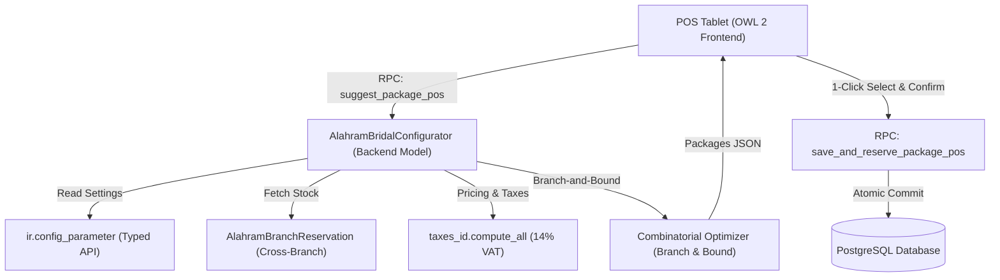

# Al Ahram Retail POS - Bridal Package Budget Recommendation Technical Design

Document Reference: [BRIDAL_BUDGET_RECOMMENDATION_TECHNICAL_DESIGN.md](file:///d:/WORK/Odoo20-interbrise/docs/BRIDAL_BUDGET_RECOMMENDATION_TECHNICAL_DESIGN.md)
Module: [alahram_retail_demo](file:///d:/WORK/Odoo20-interbrise/ALAhram/alahram_retail_demo)
Platform: Odoo 20 Enterprise

---

## 1. System Architecture Overview

The Intelligent Budget-Constrained Bridal Package Recommendation Engine is built entirely on native Odoo 20 Enterprise architecture, combining a high-performance Python backend combinatorial engine with an asynchronous OWL (Odoo Web Library) frontend dialog.



---

## 2. Data Models and Schema Changes

### 2.1 Settings Model Extension ([res_config_settings.py](file:///d:/WORK/Odoo20-interbrise/ALAhram/alahram_retail_demo/models/res_config_settings.py))
Extends `res.config.settings` with administrative parameters persisted to `ir.config_parameter`:
- `bridal_tolerance_below` (`fields.Float`, default `2000.0`): Lower tolerance bound.
- `bridal_tolerance_above_pref` (`fields.Float`, default `2500.0`): Preferred upper tolerance bound.
- `bridal_tolerance_above_abs` (`fields.Float`, default `3000.0`): Absolute upper tolerance bound.
- `bridal_max_recommendations` (`fields.Integer`, default `3`): Max distinct packages to generate.
- `bridal_enable_extended_range` (`fields.Boolean`, default `True`): Flag enabling extended range fallback.
- `bridal_consider_cross_branch` (`fields.Boolean`, default `True`): Flag enabling cross-branch network stock evaluation.

### 2.2 Configurator Model Extension ([alahram_bridal_configurator.py](file:///d:/WORK/Odoo20-interbrise/ALAhram/alahram_retail_demo/models/alahram_bridal_configurator.py))
Extends [`AlahramBridalConfigurator`](file:///d:/WORK/Odoo20-interbrise/ALAhram/alahram_retail_demo/models/alahram_bridal_configurator.py#L12-L1535) with fields:
- `recommendation_type` (`fields.Selection`): `economy`, `best_match`, `premium`, `extended`, `custom`.
- `budget_match_status` (`fields.Selection`): `below_budget`, `matches_budget`, `within_preferred`, `slightly_above_preferred`, `out_of_bounds`, `no_solution`.
- `lower_bound` (`fields.Float`, computed, stored): Calculated as $\max(0, B - T_{below})$.
- `preferred_upper_bound` (`fields.Float`, computed, stored): Calculated as $B + T_{pref}$.
- `absolute_upper_bound` (`fields.Float`, computed, stored): Calculated as $B + T_{abs}$.
- `tax_amount` (`fields.Float`, computed, stored): Total calculated VAT for all lines.
- `tax_included_total` (`fields.Float`, computed, stored): Total customer payable amount.
- `recommendation_options_json` (`fields.Text`): Serialized cache of alternative packages.
- `recommendation_reason` (`fields.Text`): Arabic description of package selection rationale.

---

## 3. Combinatorial Optimization Algorithm

### 3.1 Problem Definition
Given $k$ selected cookware sectors $S_1, S_2, \dots, S_k$, each sector contains candidate products $C_i = \{p_{i,1}, p_{i,2}, \dots, p_{i,m_i}\}$. Each product $p$ has a tax-included payable price $c(p)$ and branch availability score $a(p)$.
Find distinct combinations $x = (p_1, p_2, \dots, p_k) \in S_1 \times S_2 \times \dots \times S_k$ satisfying:
$$L \le \sum_{i=1}^{k} c(p_i) \le U_{abs}$$

### 3.2 Bounded Branch-and-Bound with Suffix Pruning
To achieve sub-5 millisecond response times on large catalogs, the engine precomputes suffix bounds:
1. Suffix minimum bound:
   $$M_{min}[i] = \sum_{j=i}^{k} \min_{p \in S_j} c(p)$$
2. Suffix maximum bound:
   $$M_{max}[i] = \sum_{j=i}^{k} \max_{p \in S_j} c(p)$$
3. **Pruning Condition**: At step $i$ with accumulated cost $A$:
   - If $A + M_{min}[i] > U_{abs}$, prune branch immediately (cannot remain under absolute upper bound).
   - If $A + M_{max}[i] < L$, prune branch immediately (cannot reach minimum budget floor).

### 3.3 Candidate Sorting and Heuristic Selection
Valid combinations are partitioned into:
- Preferred Set: $\mathcal{P} = \{x \mid \sum c(x) \le U_{pref}\}$
- Extended Set: $\mathcal{E} = \{x \mid U_{pref} < \sum c(x) \le U_{abs}\}$

Packages are generated by sorting candidates with composite scoring:
- **Best Match**: Sorted by $(\ | \sum c(x) - B \ |, -\sum a(p)\ )$.
- **Economy**: Sorted by $(\ \sum c(x), -\sum a(p)\ )$.
- **Premium**: Sorted by $(\ -\sum c(x), -\sum a(p)\ )$.

---

## 4. API and RPC Specifications

### 4.1 RPC: `suggest_package_pos`
- **Method Signature**: `suggest_package_pos(self, vals)`
- **Request Payload**:
  ```json
  {
    "target_budget": 20000.0,
    "sectors": ["granite", "stainless", "frypans", "bakeware"],
    "pos_config_id": 1,
    "partner_id": 42
  }
  ```
- **Response Payload**:
  ```json
  {
    "success": true,
    "has_solution": true,
    "target_budget": 20000.0,
    "lower_bound": 18000.0,
    "preferred_upper_bound": 22500.0,
    "absolute_upper_bound": 23000.0,
    "bounds": {
      "lower_bound": 18000.0,
      "preferred_upper_bound": 22500.0,
      "absolute_upper_bound": 23000.0
    },
    "recommendations": [
      {
        "type": "economy",
        "name": "باكدج اقتصادي مناسب",
        "total_price": 18500.0,
        "variance": -1500.0,
        "lines": [...]
      },
      {
        "type": "best_match",
        "name": "الباكدج الأفضل تطابقاً مع الميزانية",
        "total_price": 20050.0,
        "variance": 50.0,
        "lines": [...]
      },
      {
        "type": "premium",
        "name": "باكدج مميز ضمن حدود التسامح",
        "total_price": 22300.0,
        "variance": 2300.0,
        "lines": [...]
      }
    ],
    "active_recommendation": { ... }
  }
  ```

### 4.2 RPC: `save_and_reserve_package_pos`
- **Method Signature**: `save_and_reserve_package_pos(self, vals)`
- Validates that total price does not exceed $U_{abs}$ unless authorized by an Operations Manager.
- Atomically creates `alahram.bridal.configurator` and calls `alahram.branch.reservation.create_from_pos()`.

---

## 5. OWL 2 Frontend Architecture

- **Component**: [`BridalPackageDialog`](file:///d:/WORK/Odoo20-interbrise/ALAhram/alahram_retail_demo/static/src/app/bridal_package/bridal_package_dialog.js)
- **Template**: [`bridal_package_dialog.xml`](file:///d:/WORK/Odoo20-interbrise/ALAhram/alahram_retail_demo/static/src/app/bridal_package/bridal_package_dialog.xml)
- **Key Reactive State**:
  - `this.state.targetBudget`: User-entered budget.
  - `this.state.lowerBound`, `this.state.preferredUpperBound`, `this.state.absoluteUpperBound`: Administrative bounds.
  - `this.state.recommendedPackages`: Array of generated package options.
  - `this.state.selectedPackageType`: Active card index.
  - `this.state.budgetMatchStatus`: Real-time status badge evaluator.
- **1-Click Package Switch**: Clicking any recommendation card invokes `selectRecommendedPackage(pkg)`, seamlessly swapping the bill of materials, recalculating taxes, and updating branch sourcing badges.
