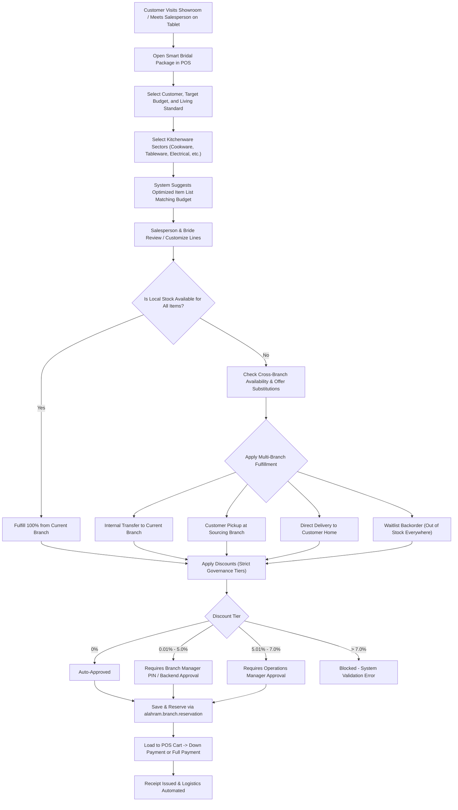

# Al Ahram Cookware - Smart Bridal Package POS Business Workflow

## 1. Executive Summary

The Smart Bridal Package system ("تجهيز باكدج العروسة الذكي") integrates customized cookware package configuration into the Odoo 20 Enterprise Point of Sale tablet interface. The solution connects directly to Al Ahram's multi-branch retail network and inventory backbone, reusing the cross-branch availability and reservation engine ("التوافر والحجز من الفروع") without duplicating stock tables or business logic.

This document describes the end-to-end retail business workflows, approval governance, multi-branch fulfillment models, payment processing, cancellation procedures, and operational exception paths.

---

## 2. Business Process Overview

---

## 3. Step-by-Step Retail Workflow

### Step 3.1: Session Initiation & Customer Profiling
1. **Salesperson Touchscreen Access**:
   - The salesperson opens the active POS session on a mobile tablet.
   - Taps the primary action button labeled **باكدج العروسة الذكي** on the top action bar or inside the POS hamburger menu.
2. **Customer Selection**:
   - The salesperson selects an existing customer or creates a new customer profile directly within the modal.
3. **Budget & Lifestyle Parameters**:
   - Enter target bridal budget in EGP (e.g., 25,000 EGP).
   - Select living standard tier: Economy (اقتصادي), Middle (متوسط), or Luxury (فاخر).
   - Select customer delivery preference: Branch Handover, Consolidated Transfer, or Direct Home Delivery.

### Step 3.2: Sector & Category Selection
1. The salesperson and bride select the target product sectors:
   - Cookware & Pots (أواني الطهي والجرانيت والتيفال)
   - Cutlery & Tableware (أطقم المائدة والسكاكين)
   - Small Kitchen Appliances (الأجهزة الكهربائية الصغيرة)
   - Kitchen Accessories & Tools (أدوات المطبخ والتقديم)
2. The user taps **Suggest Optimized Package** (اقتراح الباكدج الذكي).
3. The algorithmic engine distributes the target budget across the chosen sectors according to standard culinary allocation weights and auto-selects top-selling Al Ahram products within the living standard tier.

### Step 3.3: Product Customization & Real-Time Stock Availability
1. The suggested lines load into the tablet table.
2. For each line, the system queries the active warehouse free stock (`qty_free`).
3. Stock indicators are displayed:
   - **Green Badge (متوفر محلياً)**: Stock is fully available in the current branch.
   - **Yellow Badge (متوفر بفروع أخرى)**: Insufficient stock locally, but available across the Al Ahram branch network (e.g., Maadi, Nasr City, Alexandria, Central Warehouse).
   - **Red Badge (غير متوفر)**: Completely out of stock in all branches.

### Step 3.4: Product Substitutions (Customer-Approved Alternatives)
When an item is unavailable locally or customer requests a variant:
1. The salesperson taps **Alternatives** (بدائل الصنف).
2. The system executes `get_product_alternatives_pos()`:
   - Finds products sharing the same POS category and cookware material.
   - Considers items with unit prices within +/- 20% of the original item.
   - Displays real-time local and network stock for each candidate.
3. The salesperson presents options to the customer.
4. Upon customer agreement, tapping **Select Alternative** replaces the line, sets `is_alternative = True`, captures the `original_product_id`, and logs the substitution reason into the audit trail.

### Step 3.5: Multi-Branch Fulfillment Allocation
For items unavailable in the current branch, the salesperson clicks **Branch Sourcing** (تخصيص الفروع):
The system utilizes the integrated `alahram.branch.reservation` engine to assign fulfillment strategies:
- **Consolidated Transfer (`transfer`)**: Remote branch dispatches stock via internal stock picking (`stock.picking`) to the salesperson's branch. The customer picks up the entire consolidated package once all transfers arrive.
- **Source Branch Pickup (`pickup`)**: The bride prefers picking up specific items directly from another branch location (e.g., closer to her home or wedding venue).
- **Direct Delivery (`direct_delivery`)**: The central warehouse or sourcing branch delivers large sets directly to the bride's home address.
- **Split Allocation**: If 5 units are needed, 2 units can be fulfilled locally, 2 units from Nasr City Branch, and 1 unit from Central Warehouse.
- **Backorder Waitlist (`waitlist`)**: If an item is completely out of stock across all locations, the line is assigned to `alahram.branch.waitlist.line` with target restock tracking.

---

## 4. Multi-Tier Discount Governance

To safeguard retail gross margins while giving sales teams flexibility during peak wedding seasons, strict tiered discount rules are enforced programmatically in both Python backend and OWL frontend:

| Discount Rate | Authorization Level | Enforcement Mechanism |
| :--- | :--- | :--- |
| **0.00%** | Salesperson | Auto-approved. Package proceeds immediately. |
| **0.01% - 5.00%** | Branch Manager | Requires Branch Manager PIN authorization on POS tablet or manager validation in backend. |
| **5.01% - 7.00%** | Operations Manager | State moves to `pending_discount_approval`. Requires Operations Manager backend approval. |
| **> 7.00%** | Strictly Forbidden | Blocked at ORM layer (`ValidationError`) and tablet UI. Cannot be submitted under any role. |

### Discount Calculation Rules:
- Discounts apply uniformly or per line, but the total package discount percentage determines the approval tier:
  $$\text{Effective Discount \%} = \frac{\text{Total Undiscounted Price} - \text{Discounted Package Total}}{\text{Total Undiscounted Price}} \times 100$$
- Any modification to package lines after approval automatically resets the approval state to draft (`draft`), preventing unauthorized post-approval item swaps.

---

## 5. POS Checkout, Reservation, and Payment

1. **Atomic Reservation Execution**:
   - When the salesperson clicks **Save & Reserve Package** (حفظ وحجز الباكدج), the system calls `save_and_reserve_package_pos()`.
   - An `alahram.branch.reservation` record is generated with allocations linked to `alahram.bridal.configurator`.
   - Stock quantities in remote branches are immediately soft-reserved (preventing duplicate sale by another branch).
2. **Loading into POS Cart**:
   - The salesperson clicks **Load to POS Cart** (تحميل إلى السلة).
   - All package lines, approved quantities, customized unit prices, and discounts are injected into the active POS order.
   - The POS order captures references to `bridal_configurator_id` and `reservation_id`.
3. **Payment Flexibility**:
   - **Full Payment**: Customer pays 100% via Cash, Visa, or Mixed payment methods. POS order closes and receipt prints with package reservation ID.
   - **Down Payment / Deposit**: Customer pays reservation deposit (e.g., 20% or 50%). System logs advance payment against customer account and reservation lines remain active until final dispatch.

---

## 6. Package Cancellation & Exception Workflows

### 6.1 Customer Cancellation Prior to Delivery
If a customer cancels the bridal package order:
1. Salesperson or Branch Manager opens the Bridal Package record or cancellation dialog.
2. Clicking **Cancel Package and Release Stock** triggers `action_cancel_package_and_reservation()`:
   - Sets `alahram.bridal.configurator` status to `cancel`.
   - Cascades cancellation to `alahram.branch.reservation`.
   - Releases all reserved stock allocations across all participating branches.
   - Cancels draft or waiting stock pickings (`stock.picking`).
   - If a deposit was collected, POS generates a credit note or cash refund receipt according to store policy.

### 6.2 Remote Branch Out-of-Stock / Rejection Exception
If a sourcing branch discovers damaged goods or discrepancy during physical picking:
1. Source branch marks the allocation line as rejected with an exception note.
2. The POS system flags an alert on the Bridal Package record.
3. The salesperson can open the package, trigger substitution or re-route allocation to an alternate warehouse, and confirm the updated reservation.

