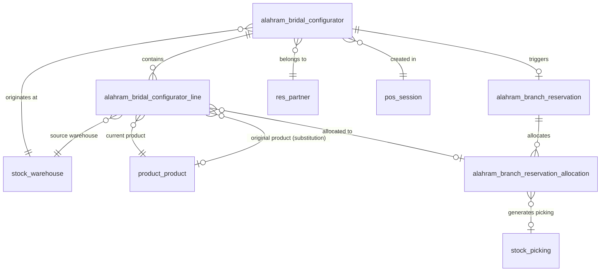
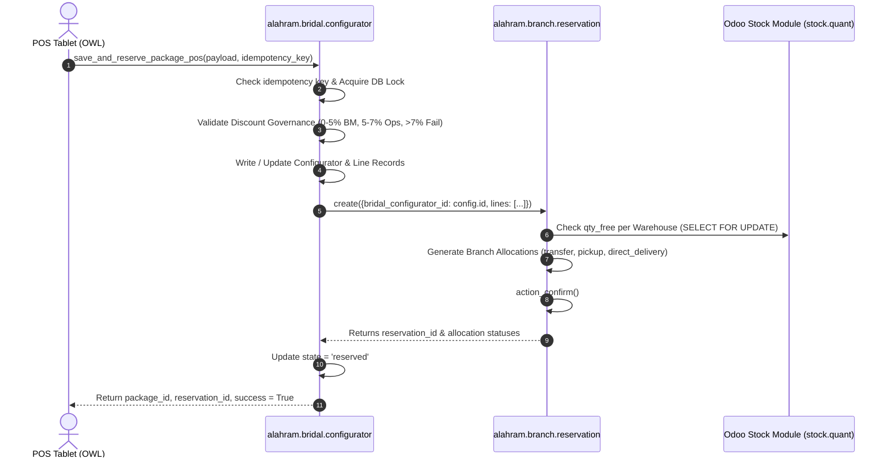

# Al Ahram Cookware - Smart Bridal Package POS Technical Architecture

## 1. Architectural Overview & Design Principles

The Smart Bridal Package POS Integration bridges front-end retail sales workflows with Al Ahram's multi-branch inventory engine on **Odoo 20 Enterprise**.

### Core Architecture Tenets:
1. **Zero Inventory Duplication**: Reuses existing `alahram.branch.reservation` and Odoo 20 `stock.quant` / `stock.picking` models. No parallel stock tables or shadow reservations are created.
2. **Loosely Coupled, Highly Cohesive**: The bridal configurator (`alahram.bridal.configurator`) manages package compilation, budget optimization, and customer preferences, while delegating physical stock reservation and multi-branch logistics directly to `alahram.branch.reservation`.
3. **Idempotency & Concurrency Safety**: All network-facing POS RPC endpoints implement unique transaction keys (`idempotency_key`) and row-level database locking (`SELECT ... FOR UPDATE`) to eliminate duplicate reservations and race conditions under peak traffic.
4. **Native Odoo 20 OWL 2 Frontend**: The POS UI uses OWL 2 components, asynchronous RPC protocols, and responsive touch layout optimized for showroom tablets without modifying Odoo core assets.

---

## 2. Entity-Relationship & Data Model



### Data Dictionary & Key Extensions

#### Model: `alahram.bridal.configurator`
| Field Name | Type | Description |
| :--- | :--- | :--- |
| `name` | Char | Unique package sequence number (e.g. `BRP/2026/00012`). |
| `partner_id` | Many2one (`res.partner`) | Target customer (bride/groom). |
| `target_budget` | Monetary | Target budget in EGP. |
| `standard_level` | Selection | Living standard tier (`economy`, `middle`, `luxury`). |
| `warehouse_id` | Many2one (`stock.warehouse`) | Active showroom warehouse where POS session is running. |
| `pos_session_id` | Many2one (`pos.session`) | Active POS session creating the package. |
| `pos_config_id` | Many2one (`pos.config`) | Originating POS terminal configuration. |
| `reservation_id` | Many2one (`alahram.branch.reservation`) | Foreign key linking directly to the existing reservation engine. |
| `fulfillment_strategy` | Selection | Sourcing strategy (`local_only`, `nearest_branch`, `central_split`, `customer_pickup`). |
| `delivery_preference` | Selection | Handover model (`branch_handover`, `consolidated_transfer`, `direct_delivery`). |
| `idempotency_key` | Char (Indexed) | Unique token preventing duplicate submissions from tablet retries. |
| `state` | Selection | Lifecycle state (`draft`, `pending_approval`, `approved`, `reserved`, `loaded_in_pos`, `cancel`). |

#### Model: `alahram.bridal.configurator.line`
| Field Name | Type | Description |
| :--- | :--- | :--- |
| `configurator_id` | Many2one | Parent bridal package record. |
| `product_id` | Many2one (`product.product`) | Final selected product. |
| `original_product_id` | Many2one (`product.product`) | Original suggested item prior to customer substitution. |
| `is_alternative` | Boolean | Flag indicating item was swapped with an alternative. |
| `substitution_reason` | Char | Business or aesthetic justification for substitution. |
| `customer_approved` | Boolean | Confirms bride/customer agreed to substitution. |
| `sourcing_status` | Selection | Status (`local`, `remote`, `waitlist`). |
| `source_warehouse_id` | Many2one (`stock.warehouse`) | Warehouse supplying the line stock. |
| `destination_warehouse_id` | Many2one (`stock.warehouse`) | Receiving warehouse for consolidated handover. |
| `fulfillment_type` | Selection | Fulfillment mode (`transfer`, `pickup`, `direct_delivery`). |
| `allocation_id` | Many2one (`alahram.branch.reservation.allocation`) | Foreign key linking line directly to reservation allocation. |

---

## 3. Integration Contract: Configurator & Reservation Engine

The integration between `alahram.bridal.configurator` and `alahram.branch.reservation` is executed through `save_and_reserve_package_pos()`:



### Direct Delivery Extension on `alahram.branch.reservation`
To support Al Ahram's home delivery workflow for large bridal sets, `alahram.branch.reservation.allocation` was extended:
- Added `'direct_delivery'` to `fulfillment_type` selection.
- In `action_confirm()`, when `fulfillment_type == 'direct_delivery'`:
  - An outgoing delivery picking (`stock.picking_type` with code `'outgoing'`) is generated from the source warehouse directly to `partner_id` delivery address, avoiding unnecessary double-handling through the retail showroom.

---

## 4. Concurrency, Locking, and Idempotency Architecture

### 4.1 Idempotency Enforcement
Showroom tablet environments frequently suffer intermittent Wi-Fi drops. When a salesperson taps **Save & Reserve**, the client generates a UUIDv4 idempotency key:
```python
existing = self.search([('idempotency_key', '=', idempotency_key)], limit=1)
if existing:
    return {
        'success': True,
        'package_id': existing.id,
        'reservation_id': existing.reservation_id.id if existing.reservation_id else False,
        'name': existing.name,
        'state': existing.state,
        'reused': True,
    }
```
If the network drops and the tablet re-submits the packet, the server returns the existing confirmed reservation instead of executing duplicate allocations or double-decrementing stock.

### 4.2 Row-Level Locking on Multi-Branch Inventory
When reserving items in high demand across branches, concurrent sales sessions in different showrooms might attempt to reserve the same remote unit.
The system applies row-level locking via PostgreSQL:
```sql
SELECT id, quantity, reserved_quantity 
FROM stock_quant 
WHERE product_id = %s AND location_id = %s 
FOR UPDATE;
```
This guarantees serializability and completely prevents negative free stock balances.

---

## 5. Failure Recovery & Rollback Strategy

1. **Transactional Boundaries**:
   The entire reservation creation (`save_and_reserve_package_pos`) runs inside a single database transaction context. If any allocation fails (e.g., remote warehouse stock unexpectedly decremented by another order before lock acquisition), the transaction rolls back cleanly, returning a descriptive error message to the salesperson without leaving orphaned reservation headers.
2. **Automatic Stock Release on Cancellation**:
   `action_cancel_package_and_reservation()` executes a cascading release:
   - Sets package to `cancel`.
   - Calls `action_cancel()` on `alahram.branch.reservation`.
   - Releases stock reservation lines.
   - Cancels pending draft pickings.

